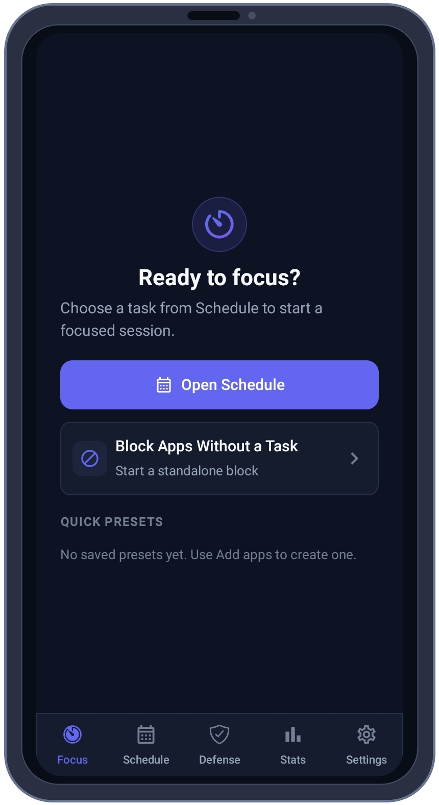
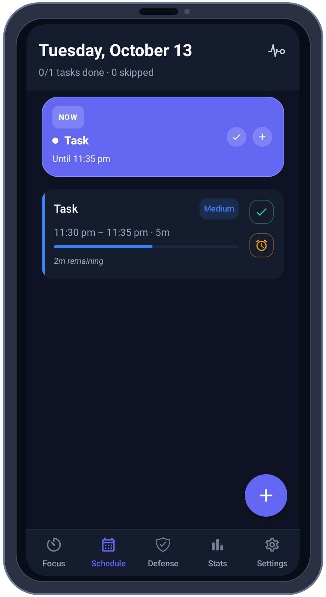
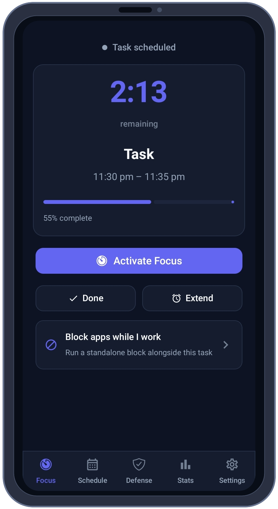
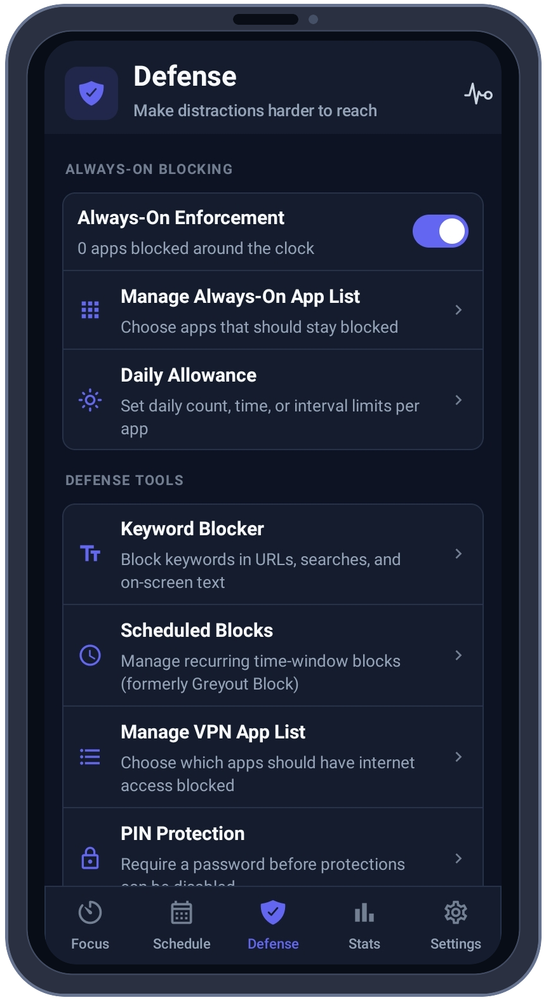
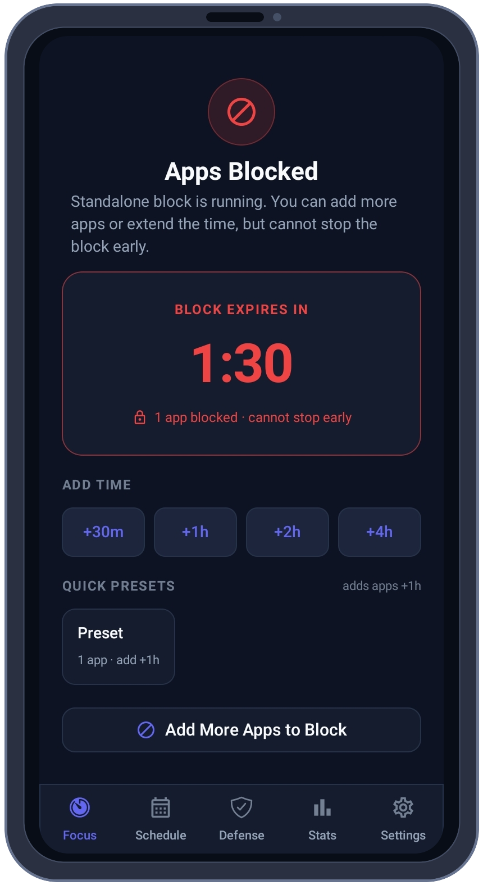
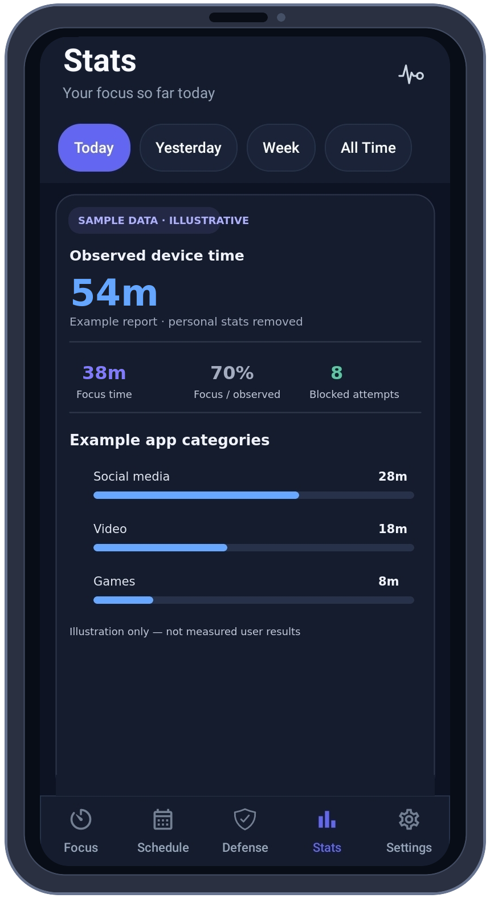
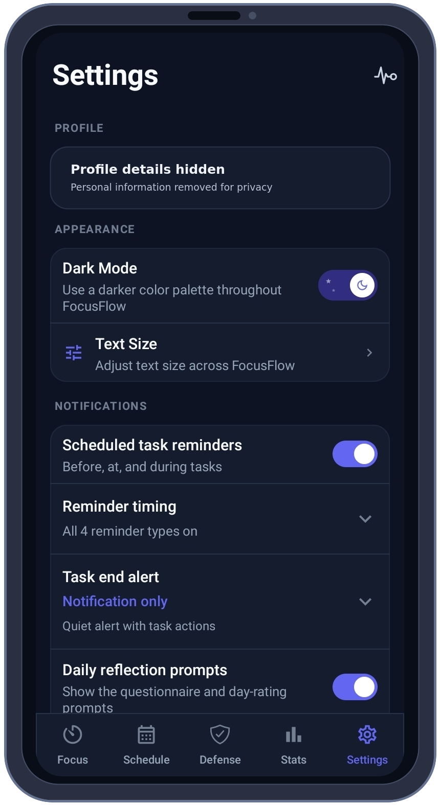

<div align="center">


# FocusFlow: Open-Source App Blocker & Focus Planner for Android

**Make room for focus. Keep distractions out.**

Block distracting apps, plan focused work sessions and build routines that stick, with layered protection that runs entirely on your phone.<br />
Native Kotlin · Jetpack Compose · no ads · no account · no root

[**⬇ Download the APK**](https://github.com/TITANICBHAI/FocusFlow/releases/latest) &nbsp;·&nbsp; [Huawei AppGallery](https://appgallery.huawei.com/app/C117698039) &nbsp;·&nbsp; [Website](https://focusflowapp.pages.dev/) &nbsp;·&nbsp; [Features](#features) &nbsp;·&nbsp; [FAQ](#faq)

[](https://github.com/TITANICBHAI/FocusFlow/releases)
[](LICENSE)


</div>

---

## What is FocusFlow?

**FocusFlow is a free, open-source Android app that blocks distracting apps and helps you plan the work you actually want to do.** Add a task, start a focus session, and FocusFlow keeps the apps you chose out of reach. It combines Android's Accessibility Service, an optional on-device VPN and optional Device Admin protection, with a PIN that only you control. It is built natively in Kotlin and Jetpack Compose, needs no root, shows no ads, and keeps your tasks, settings and stats on your phone.

Use it to study without your phone pulling you away, protect deep-work blocks, cut down on short-form video (YouTube Shorts, Instagram Reels, TikTok), set daily limits for social apps, or run a digital detox on a schedule.

| At a glance | |
|---|---|
| **What it is** | App blocker, focus timer and task planner for Android |
| **Price** | Free. No ads, no subscription, no in-app purchases |
| **License** | Open source, GNU AGPL-3.0 |
| **Works on** | Android 10 (API 29) and newer. No root required |
| **Privacy** | Data stays on your device (Room/SQLite). No accounts, no analytics or advertising SDKs |
| **Language** | English app. The [website](https://focusflowapp.pages.dev/) is available in 7 languages |
| **Package ID** | `com.tbtechs.focusflow` |
| **Built with** | Kotlin 2.0 · Jetpack Compose (Material 3) · Room · Coroutines · WorkManager |
| **Developer** | [TBTechs](https://tbtechs.pages.dev) |

## Why people use FocusFlow

- **Plan first, then block.** Put work on your schedule, start a focus session from any task, and blocking begins with a countdown, reminders and an end-of-session alarm. Recurring *Scheduled Blocks* switch on by themselves.
- **Harder to talk yourself out of.** Layered protection: Accessibility Service blocking, optional per-app network blocking through a local VPN, optional Device Admin, System Guard, and a PIN you must enter before protections can be turned off.
- **Block the feed, not the whole app.** Optional YouTube Shorts and Instagram Reels blockers redirect you away from the short-video player while the rest of the app stays usable.
- **See what is really happening.** A Temptation Log records blocked attempts, a weekly report summarises them, and on-device stats show where your time goes.
- **Private by design.** No account, no ads, no analytics SDKs. Everything lives in a local database on your phone, and the source code is public so you can check.

## Screenshots

The screenshots below are framed and cropped to remove the phone's status and system navigation bars. Profile details are redacted. **The Stats image uses clearly labeled illustrative data, not measured results.**

<table>
  <tr>
    <td align="center"><br /><sub>Start focus or block apps</sub></td>
    <td align="center"><br /><sub>Plan tasks and sessions</sub></td>
    <td align="center"><br /><sub>Keep a session on track</sub></td>
  </tr>
  <tr>
    <td align="center"><br /><sub>Choose your protections</sub></td>
    <td align="center"><br /><sub>Stay with a timed block</sub></td>
    <td align="center"><br /><sub>Stats · illustrative sample data</sub></td>
  </tr>
  <tr>
    <td colspan="3" align="center"><br /><sub>Settings · profile details redacted</sub></td>
  </tr>
</table>

## Features

### Plan your focus

- **Tasks and schedule** with a timeline view, quick add, and per-task allowed apps.
- **Subtasks** for routines and step-by-step work, with optional timers and photos.
- **Focus sessions** with a countdown, extend controls and an end-of-session debrief.
- **Pomodoro cycles** with configurable work and break lengths (optional).
- **Reminders and task-end alarms**, a live status notification and a home-screen widget.
- **Rate your day** prompts that feed your stats.

### Block distractions

| Mode | What it does |
|---|---|
| **Task-based blocks** | During a focus session, only the apps you allow for that task are usable |
| **Standalone blocks** | Start an instant, timed block without creating a task, with quick presets |
| **Scheduled Blocks** | Recurring time windows (for example weeknights) that switch on automatically |
| **Always-On Enforcement** | Keep chosen apps blocked around the clock |
| **Daily Allowance** | Set daily open-count, time-budget or interval limits per app |
| **Keyword Blocker** | Block keywords in URLs, searches and on-screen text |
| **Local VPN blocking** | Optional. Cut internet access for selected apps through an on-device VPN. No traffic goes to a server |
| **Shorts and Reels blockers** | Optional. Redirect away from the YouTube Shorts player and the Instagram Reels viewer |
| **Sideload Guard** | Apps installed during a protected session are blocked too |
| **Focus Launcher** | Optional. Use FocusFlow as a minimal home screen that intercepts blocked launches |
| **Nuclear Mode** | Pick apps from your block list and uninstall them for good (Android asks you to confirm) |

### Stay accountable

- **PIN protection**: require a PIN before protections can be disabled.
- **System Guard** and optional **Device Admin** add resistance to force-stopping or uninstalling FocusFlow mid-session.
- **Temptation Log** records blocked attempts (the latest 500), with a **weekly report** every Sunday morning.
- **Aversive feedback** (optional, off by default): screen dim, vibration and sound when a blocked app opens.
- **Boot recovery** restarts protection after a reboot.

### Understand your habits

- Focus reports, on-device usage stats, trend charts, achievements and streaks, and plain-language insights.
- Everything is calculated on your phone from Android's own usage data.

### Your data stays yours

- **Backup and restore** your setup as a `.focusflow` file ([file format](https://focusflowapp.pages.dev/focusflow-file-format/)).
- Built-in diagnostics, troubleshooting and a how-to guide.
- Light and dark themes with adjustable text size.

## How it works

1. **Install and grant three required permissions.** Accessibility Service, Usage Access and Appear on Top. FocusFlow walks you through each one.
2. **Choose what to protect.** Add a task with allowed apps, start an instant block, or set up Always-On, Scheduled Blocks, daily allowances or keywords on the Defense tab.
3. **Focus.** When a blocked app comes to the foreground, FocusFlow redirects you to a block screen before you can use it. Optional layers (VPN, Device Admin, PIN) make it harder to switch off.

### Permissions explained

| Permission | Required | Why FocusFlow asks |
|---|---|---|
| Accessibility Service | Yes | Sees which app is in the foreground and redirects blocked apps before they open. The in-app screen states it reads the foreground app name only |
| Usage Access | Yes | Detects the foreground app and powers on-device stats |
| Appear on Top | Yes | Shows the block screen over other apps |
| VPN | Optional | Local on-device tunnel that cuts network access for apps you select. Android shows its own consent dialog |
| Device Admin | Optional | Adds resistance to force-stop controls |
| Notifications, Exact Alarms, Full-screen Alarms | Optional | Reminders and task-end alerts that fire on time |
| Battery Optimization | Optional | Helps the service keep running on phones that stop background apps |
| Home Launcher | Optional | Intercepts blocked launches before they open |

## Download and install

| Where | Link |
|---|---|
| **GitHub Releases** (signed APKs) | [Latest release](https://github.com/TITANICBHAI/FocusFlow/releases/latest) |
| Huawei AppGallery | [FocusFlow on AppGallery](https://appgallery.huawei.com/app/C117698039) |
| Mobile Seva AppStore | [apps.gov.in](https://apps.gov.in/app-info/2691) |
| Indus Appstore | [indusapp.store](https://indusapp.store/kcf38kt1) |
| Google Play | Not available at the moment |

**Which APK should I pick?** Releases include `arm64-v8a` (most phones from the last several years), `armeabi-v7a` (older 32-bit phones) and a `universal` APK. If you are unsure, take the universal one.

**Install steps**

1. Download the APK on your phone and open it. If Android asks, allow your browser or file manager to install unknown apps.
2. Open FocusFlow and follow the permission setup.
3. On Android 13 and newer, if the Accessibility toggle is greyed out, open **App info → ⋮ menu → Allow restricted settings**, then go back. FocusFlow shows these steps in the app too.

## FocusFlow vs. other app blockers

Built-in screen-time timers and reminders are designed to nudge you, and they are usually easy to snooze or switch off in a couple of taps. FocusFlow is designed to enforce what you decided in a calm moment: layered blocking, a PIN, Always-On mode and a Temptation Log that shows what you reached for.

Looking for a free, open-source alternative to subscription blockers such as Freedom, Opal or AppBlock, or an Android counterpart to desktop blockers such as Cold Turkey? FocusFlow covers scheduled and on-demand app blocking, daily limits and usage stats with no premium tier. It is Android-only and does not sync between devices. More on the website: [feature list](https://focusflowapp.pages.dev/features/), [comparison](https://focusflowapp.pages.dev/compare/), [alternatives](https://focusflowapp.pages.dev/alternatives/).

Guides: [block YouTube Shorts](https://focusflowapp.pages.dev/blog/how-to-block-youtube-shorts-android/) · [block Instagram Reels](https://focusflowapp.pages.dev/blog/how-to-block-instagram-reels-android/) · [block TikTok](https://focusflowapp.pages.dev/blog/how-to-block-tiktok-android/) · [stop doom scrolling](https://focusflowapp.pages.dev/blog/how-to-stop-doom-scrolling/) · [stop phone addiction](https://focusflowapp.pages.dev/blog/how-to-stop-phone-addiction-android/)

## FAQ

### Is there a free, open-source app blocker for Android?

Yes. FocusFlow is free, has no ads and no premium tier, and its full source code is public under the AGPL-3.0 license in this repository.

### How does FocusFlow block apps?

Android's Accessibility Service notices when a blocked app reaches the foreground, and FocusFlow redirects you to a block screen before the app can be used. Usage Access and the Appear on Top permission support detection and the block screen. Optional layers add resistance: a local VPN that cuts network access for selected apps, Device Admin and System Guard against force-stopping or uninstalling mid-session, and a PIN required before protections can be disabled.

### How do I block YouTube Shorts or Instagram Reels on Android?

Open the **Defense** tab and turn on *Block YouTube Shorts* or *Block Instagram Reels*. FocusFlow redirects you away from the Shorts player or the Reels viewer, so the rest of YouTube and Instagram stays available.

### Which Android versions are supported? Does it need root?

Android 10 (API 29) or newer, and no root. FocusFlow targets Android 15 (API 35).

### What permissions does FocusFlow need, and why?

Three are required: Accessibility Service, Usage Access and Appear on Top. Everything else (VPN, Device Admin, notifications, exact alarms, battery optimization, home launcher) is optional. See [Permissions explained](#permissions-explained). FocusFlow also explains each permission inside the app.

### Does FocusFlow collect or upload my data?

No analytics, advertising or crash-reporting SDKs are included, and there are no accounts. Tasks, settings and stats are stored in a local database on your phone, and backups are `.focusflow` files that you export yourself. The optional VPN is a local on-device tunnel, not a remote server. You can check all of this in the source, and the [privacy policy](https://focusflowapp.pages.dev/privacy-policy/) explains it in plain language.

### Can I still bypass FocusFlow?

No Android app can be fully tamper-proof against a determined person with physical access to their own phone, for example through Safe Mode, ADB or a factory reset. FocusFlow is built to make impulsive bypassing hard: layered blocking, System Guard, optional Device Admin, a PIN, Always-On mode and boot recovery. If you need stronger guarantees, set the PIN with someone you trust.

### Is FocusFlow on Google Play?

Not at the moment. Install it from [GitHub Releases](https://github.com/TITANICBHAI/FocusFlow/releases/latest), [Huawei AppGallery](https://appgallery.huawei.com/app/C117698039), the [Mobile Seva AppStore](https://apps.gov.in/app-info/2691) or the [Indus Appstore](https://indusapp.store/kcf38kt1).

### Why is the Accessibility toggle greyed out after installing the APK?

Android 13 and newer restrict sensitive permissions for apps installed outside a store. Open **App info → ⋮ menu → Allow restricted settings** for FocusFlow, then enable the Accessibility Service again.

### Is FocusFlow a parental-control app?

No. FocusFlow is a self-control tool for your own phone. It has no remote or multi-device management and no cloud sync.

### Can I back up or move my setup to a new phone?

Yes. Export a `.focusflow` backup file and import it on the new device. See the [file format](https://focusflowapp.pages.dev/focusflow-file-format/).

### Is this the same as other apps called FocusFlow?

No. Several unrelated apps share the name. This project is the open-source Android app by TBTechs, package ID `com.tbtechs.focusflow`, with its source code in this repository.

### Was FocusFlow built with React Native or Expo?

Earlier versions of this project used React Native and Expo. Current releases are a fully native Android app written in Kotlin with Jetpack Compose.

### Is there a Windows version?

Yes. FocusFlow for Windows is a separate project: [FocusFlow-PC on GitHub](https://github.com/TITANICBHAI/FocusFlow-PC) · [website](https://focusflowpc.pages.dev/).

### Good to know

Android only (no iOS) · English app interface · no cloud sync · no remote or parental management · not on Google Play right now.

## For developers

FocusFlow is a single-module native Android app with 300+ Kotlin source files and a suite of unit and instrumented tests.

| Area | Details |
|---|---|
| Language and UI | Kotlin 2.0, Jetpack Compose, Material 3, Navigation Compose |
| Data | Room (SQLite), kotlinx.serialization for backups |
| Background work | Foreground service, WorkManager, AlarmManager, Kotlin Coroutines |
| Platform APIs | AccessibilityService, VpnService, DevicePolicyManager, UsageStatsManager, AppWidgetProvider |
| Build | Android Gradle Plugin 8.7, Gradle 8.14, JDK 17. `minSdk` 29, `targetSdk` and `compileSdk` 35 |
| Flavors | `production` (`com.tbtechs.focusflow`) and `tbtechsdev` (`com.tbtechsdev.focusflow`, installs side by side) |

### Build from source

```bash
git clone https://github.com/TITANICBHAI/FocusFlow.git
cd FocusFlow

./gradlew :app:assembleProductionDebug       # debug APK in app/build/outputs/apk/production/debug/
./gradlew :app:testProductionDebugUnitTest   # unit tests
./gradlew :app:lintProductionDebug           # Android lint
```

Release APKs (`arm64-v8a`, `armeabi-v7a`, universal) are built and signed by the GitHub Actions workflows in `.github/workflows`.

### Project layout (abridged)

```text
app/src/main/java/com/tbtechs/focusflow/
├── enforcement/     Accessibility service, VPN service, Device Admin, alarms, daily allowances
├── analytics/       On-device usage rollups, insights, achievements
├── data/            Room database, repositories, backup and restore (.focusflow)
├── domain/          Scheduler engine, PIN management
├── notifications/   Reminders and live status notifications
├── ui/              Jetpack Compose screens: home, focus, defense, stats, settings
└── widget/          Home-screen widget
```

## Contributing, security and community

- **Contribute:** read [CONTRIBUTING.md](CONTRIBUTING.md) and the [Code of Conduct](CODE_OF_CONDUCT.md). Bug reports and feature requests use the [issue templates](https://github.com/TITANICBHAI/FocusFlow/issues/new/choose).
- **Questions and ideas:** [GitHub Discussions](https://github.com/TITANICBHAI/FocusFlow/discussions).
- **Security:** please report vulnerabilities privately. See [SECURITY.md](SECURITY.md).
- **Like it?** A ⭐ on GitHub helps other people find FocusFlow.

## Also from TBTechs

- **FocusFlow for Windows**: app and website blocking for Windows ([GitHub](https://github.com/TITANICBHAI/FocusFlow-PC) · [website](https://focusflowpc.pages.dev/)).
- **TBTechs**, the indie studio behind FocusFlow: [tbtechs.pages.dev](https://tbtechs.pages.dev).

## License

FocusFlow is free software licensed under the **GNU Affero General Public License v3.0 (AGPL-3.0)**. See [LICENSE](LICENSE).
