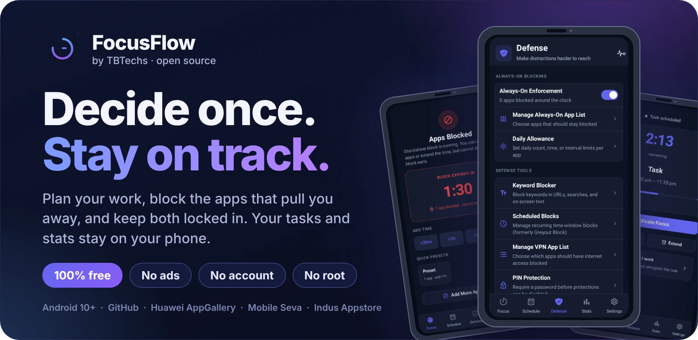
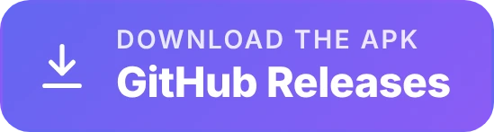
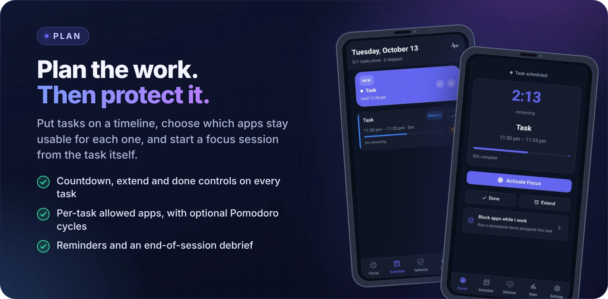
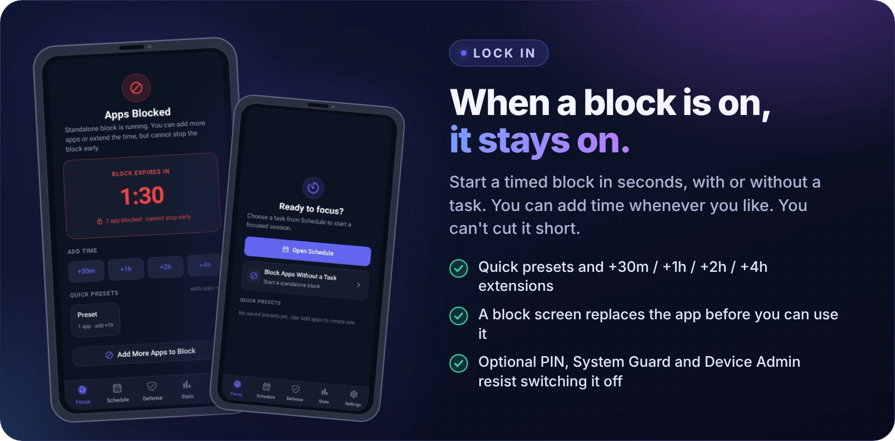
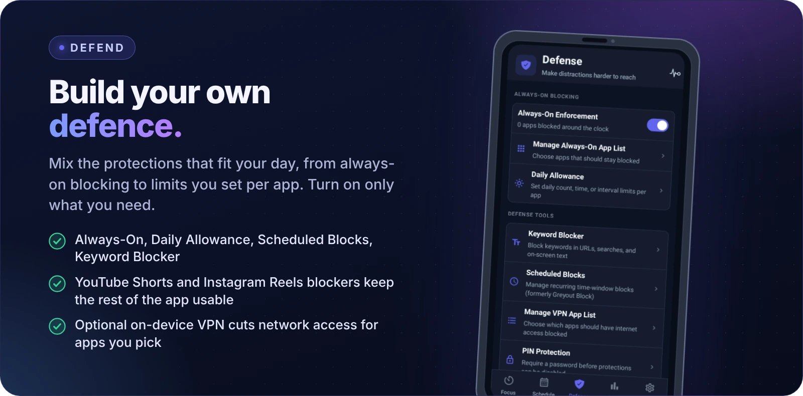
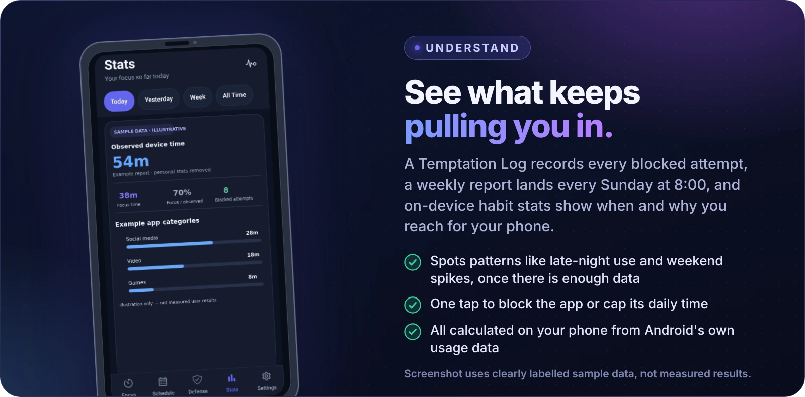
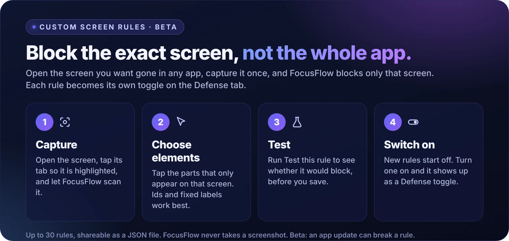
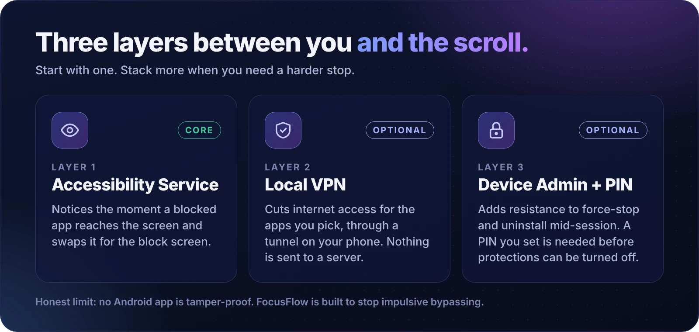

<div align="center">



# FocusFlow: Open-Source App Blocker & Focus Planner for Android

**Your phone is built to pull you away. FocusFlow is built to bring you back.**

Block distracting apps, plan the work that matters and keep both locked in with layered protection that runs on your phone.<br />
Native Kotlin · Jetpack Compose · no ads · no account · no root

<a href="https://github.com/TITANICBHAI/FocusFlow/releases/latest"></a>
<a href="https://appgallery.huawei.com/app/C117698039"></a>
<a href="https://apps.gov.in/app-info/2691"></a>
<a href="https://indusapp.store/kcf38kt1"></a>

[Website](https://focusflowapp.pages.dev/) &nbsp;·&nbsp; [Features](#features) &nbsp;·&nbsp; [How it works](#how-it-works) &nbsp;·&nbsp; [Install](#download-and-install) &nbsp;·&nbsp; [FAQ](#faq)

[](https://github.com/TITANICBHAI/FocusFlow/releases)
[](LICENSE)


</div>

---

## Why FocusFlow?

Most phone timers ask you to resist in the moment, and the moment is when willpower is weakest. FocusFlow works the other way around: **you decide once, in a calm moment, and the app holds the line when you reach for the feed.**

| A typical screen-time reminder | FocusFlow |
|---|---|
| A nudge you can snooze or switch off in a couple of taps | A timed block you can **extend but not cut short**, with an optional password needed before protections can be turned off |
| Blocks a whole app or nothing | Blocks the **YouTube Shorts player or Instagram Reels viewer** and leaves the rest of the app usable |
| Tells you your total screen time | Logs your **blocked attempts** (the latest 500) and sends a weekly report, so you see what you actually reach for |
| Often a subscription | **Free, no ads, no premium tier**, and the full source code is public |

**Free, open source and private by design:** no account, no ads, no analytics or advertising SDKs. Your tasks, settings and stats live in a local database on your phone, and you can read the code to check.

## See it in action

The screenshots below are real FocusFlow screens. The Stats screen uses clearly labelled sample data, not measured results.

<p align="center">
  
</p>
<p align="center">
  
</p>
<p align="center">
  
</p>
<p align="center">
  
</p>

<details>
<summary><b>All screenshots</b> (originals, status bar cropped, profile details redacted)</summary>

<br />

<table>
  <tr>
    <td align="center"><br /><sub>Start focus or block apps</sub></td>
    <td align="center"><br /><sub>Plan tasks and sessions</sub></td>
    <td align="center"><br /><sub>Keep a session on track</sub></td>
  </tr>
  <tr>
    <td align="center"><br /><sub>Choose your protections</sub></td>
    <td align="center"><br /><sub>Stay with a timed block</sub></td>
    <td align="center"><br /><sub>Stats · illustrative sample data</sub></td>
  </tr>
  <tr>
    <td colspan="3" align="center"><br /><sub>Settings · profile details redacted</sub></td>
  </tr>
</table>

</details>

## Beyond the basics

Most blockers stop at "pick apps, set a timer". These parts of FocusFlow go further, and each one is in the code today.

<p align="center">
  
</p>

### Block one screen, not the whole app *(beta)*

**Custom Screen Rules** let you point at the exact screen you want gone, such as a Reels tab, a Shorts player or a shopping feed, and block only that. Capture it once, pick the elements that only appear there, test the rule, and switch it on. Each rule becomes its own toggle on the Defense tab, so you can turn it on or off like any other protection.

- Up to **30 rules**, each with up to 5 matchers (view id, text, description, class, or "must be the selected tab").
- **Share rules** as a JSON file, or import a friend's. Imported rules are validated and anything invalid is refused with a reason.
- Settings, System UI, the package installer and FocusFlow itself can never be blocked by a rule.
- FocusFlow **never takes a screenshot**. It reads the element tree an app exposes to Android's accessibility service. It is marked beta because an app update can change a screen and break a rule.

### Understand your phone habits, on your phone

Open **Stats → Extra** (Overview · Apps · Habits) for screen time, unlocks, wake-ups, sessions, quick checks (sessions under a minute), the **first app you open after unlocking**, **reflex apps** you open eight or more times a day, and **rising apps** whose use has grown 1.5× or more.

FocusFlow also looks for patterns in your own usage and turns them into plain-language findings, each with a one-tap action to **block the app** or **cap its daily time**. Examples it can detect: late-night use (23:00 to 04:00), heavy daily use, weekend spikes, an app that grabs your first session of the morning, steadily rising use over four weeks, and one app quietly replacing another. Findings appear once there is enough data, and every threshold is documented in the in-app guide *How usage data is calculated*.

Optional **habit nudges** warn you shortly before the hour you usually slip, for example 15 minutes before your most-used distracting hour, with a short block ready to start. They are capped at a few a day, spaced at least 30 minutes apart, and you can switch them off at any time.

### Plan a week with any AI assistant

FocusFlow does not call any AI service. Instead, **Settings → FocusFlow File Guide** has a **Copy task-backup prompt** button. Paste it into the assistant you already use, describe your tasks, dates and time zone, and it writes a `.focusflow` file. Open that file in FocusFlow and you get a **review screen with Merge or Replace** before anything is imported. The prompt keeps the file task-only, so it cannot change your protections or settings.

### Make the block screen yours

**Settings → Overlay Appearance** lets you set your own background image from your gallery and your own rotating quotes. Leave them empty to use the built-in dark gradient and focus quotes.

### Locks that only tighten

While a block is running, you can **add** keywords and apps, but existing keywords stay locked. Scheduled block windows can't be deleted until the block ends. Turning a screen rule off, editing it or deleting it is refused while a block is active, and needs your password when password protection is on. A standalone block "cannot be stopped early".

### Safety is built in

The phone dialer and emergency apps stay reachable by default, and the optional VPN excludes them. If you truly must end a focus session, **Emergency Override** asks for confirmation and logs it. The home-screen widget shows the live task, a countdown and your next task, and deliberately shows nothing about your blocking setup.

## Popular setups

| I want to... | Do this |
|---|---|
| **Study without my phone pulling me away** | Add a task on **Schedule**, choose the apps allowed for it, then tap **Activate Focus**. Everything else is blocked until the task ends. |
| **Stop the scroll but keep the app** | **Defense → Block YouTube Shorts** and **Block Instagram Reels**. The rest of each app stays usable. |
| **Block one screen in any other app** | **Settings → Custom Screen Rules**, then capture it. See [Beyond the basics](#beyond-the-basics). |
| **Quiet evenings on autopilot** | **Defense → Scheduled Blocks**, then add a recurring window such as weeknights. Optionally cut internet for those apps too. |
| **Limit one app instead of banning it** | **Defense → Daily Allowance**: a daily open count, a daily time budget, or a cooldown between opens. |
| **Make quitting hard** | Set a **Defense password** and a **Focus session password** (8+ characters, with a "Generate for me" option), or let someone you trust set them. |
| **Start a block right now, no task needed** | **Focus → Block Apps Without a Task**, choose apps and an end time, or use a quick preset. |
| **Delete the apps for good** | **Defense → Uninstall Distracting Apps** (Nuclear Mode). Android asks you to confirm each one. |

## What is FocusFlow?

**FocusFlow is a free, open-source Android app that blocks distracting apps and helps you plan the work you actually want to do.** Add a task, start a focus session, and FocusFlow keeps the apps you chose out of reach. It combines Android's Accessibility Service, an optional on-device VPN and optional Device Admin protection, with a PIN that only you control. It is built natively in Kotlin and Jetpack Compose, needs no root, shows no ads, and keeps your tasks, settings and stats on your phone.

Use it to study without your phone pulling you away, protect deep-work blocks, cut down on short-form video (YouTube Shorts, Instagram Reels, TikTok), set daily limits for social apps, or run a digital detox on a schedule.

| At a glance | |
|---|---|
| **What it is** | App blocker, focus timer and task planner for Android |
| **Price** | Free. No ads, no subscription, no in-app purchases |
| **License** | Open source, GNU AGPL-3.0 |
| **Works on** | Android 10 (API 29) and newer. No root required |
| **Get it from** | [GitHub Releases](https://github.com/TITANICBHAI/FocusFlow/releases/latest) · [Huawei AppGallery](https://appgallery.huawei.com/app/C117698039) · [Mobile Seva AppStore](https://apps.gov.in/app-info/2691) · [Indus Appstore](https://indusapp.store/kcf38kt1) |
| **Privacy** | Data stays on your device (Room/SQLite). No accounts, no analytics or advertising SDKs |
| **Language** | English app. The [website](https://focusflowapp.pages.dev/) is available in 7 languages |
| **Package ID** | `com.tbtechs.focusflow` |
| **Built with** | Kotlin 2.0 · Jetpack Compose (Material 3) · Room · Coroutines · WorkManager |
| **Developer** | [TBTechs](https://tbtechs.pages.dev) |

## Layered protection, your way

<p align="center">
  
</p>

Start with the Accessibility Service alone, or stack the optional layers when you need a harder stop. Each one is something you switch on deliberately and Android asks for consent for each.

## Features

### Plan your focus

- **Tasks and schedule** with a timeline view, quick add, and per-task allowed apps.
- **Subtasks** for routines and step-by-step work, with optional timers and photos.
- **Focus sessions** with a countdown, extend controls and an end-of-session debrief.
- **Pomodoro cycles** with configurable work and break lengths (optional).
- **Reminders that match the task**: 10, 5 and 1 minute before, at the start, 15- and 30-minute check-ins, and one minute before the end. Task-end alerts can be a ringing alarm or a quiet notification.
- **Extend a task** and the tasks after it shift forward automatically.
- **Breaks unlock your apps** during Pomodoro cycles, then blocking resumes.
- A live status notification and a home-screen widget (live clock, current or next task, countdown and progress).
- **Daily reflection and day-rating prompts** that feed your stats.

### Block distractions

| Mode | What it does |
|---|---|
| **Task-based blocks** | During a focus session, only the apps you allow for that task are usable |
| **Standalone blocks** | Start an instant block until a time you choose, with quick presets and +30m / +1h / +2h / +4h extensions. It can't be stopped early. Advanced options add a per-app daily allowance and per-app network block |
| **Scheduled Blocks** | Recurring time windows (for example weeknights) that switch on automatically |
| **Always-On Enforcement** | Keep chosen apps blocked around the clock |
| **Daily Allowance** | Set daily open-count, time-budget or interval limits per app |
| **Keyword Blocker** | Block keywords in URLs, searches and on-screen text |
| **Local VPN blocking** | Optional. Cut internet access for selected apps through an on-device VPN. No traffic goes to a server |
| **Shorts and Reels blockers** | Optional. Redirect away from the YouTube Shorts player and the Instagram Reels viewer |
| **Custom Screen Rules** *(beta)* | Capture and block a specific screen inside any app. Up to 30 rules, shareable as JSON |
| **Protect system controls** | Optional. Blocks the power menu, the notification shade and sensitive Settings pages (Accessibility, app data, date and time, Usage Access, battery optimization, Device Admin, Developer Options, reset and Special Access) during an active focus session or block |
| **Sideload Guard** | Apps installed during a protected session are blocked too |
| **Focus Launcher** | Optional. Use FocusFlow as a minimal home screen with pinned and hidden apps, your own wallpaper and a clock style. It can lock itself during a standalone block and hide Uninstall from the long-press menu |
| **Nuclear Mode** | Pick apps from your block list and uninstall them for good (Android asks you to confirm) |

### Stay accountable

- **Password protection**: a **Defense password** guards your protections and a **Focus session password** guards ending a session. Passwords need 8+ characters, common ones are rejected, and there is a strength meter and a **Generate for me** option. They are stored only as hashes, and **there is no recovery**, so write it down or set it with someone you trust.
- **Password rotation**: when you pause Always-On Enforcement, FocusFlow asks you to set the password you will need next time. You can keep the same one at most three times a day.
- **System Guard** and optional **Device Admin** add resistance to force-stopping or uninstalling FocusFlow mid-session.
- **Temptation Log** records blocked attempts (the latest 500), with a **weekly report** every Sunday at 08:00.
- **Aversive feedback** (optional, off by default): screen dim (to 2% brightness), repeating vibration and a sound when a blocked app opens.
- **Boot recovery** restarts protection after a reboot.

### Understand your habits

- **Stats** for Today, Yesterday, Week and All Time, with trend charts and a focus summary, plus **Extra** (Overview, Apps, Habits) for phone-wide screen time, unlocks and sessions.
- **Findings and one-tap actions** that turn patterns into plain-language insights. See [Beyond the basics](#beyond-the-basics).
- **Achievements and streaks**, such as *Iron session* (a focus session without opening a blocked app once), *Quiet win* (an hour of focus with no blocked attempts) and *Three weeks* (a 21-day streak).
- Everything is calculated on your phone from Android's own usage data. FocusFlow reads up to 14 days of history the first time, then keeps a small daily summary for up to a year.

### Your data stays yours

- **Backup and restore** your setup as a `.focusflow` file ([file format](https://focusflowapp.pages.dev/focusflow-file-format/)).
- Built-in how-to guide, a *What's New* changelog, and **brand-specific troubleshooting** for the permissions Android makers hide.
- **Report an Issue** builds a diagnostic email with links, addresses and obvious secrets removed. You review the draft and press send. Nothing is sent automatically.
- Light and dark themes with adjustable text size.

## How it works

1. **Install and grant three required permissions.** Accessibility Service, Usage Access and Appear on Top. FocusFlow walks you through each one.
2. **Choose what to protect.** Add a task with allowed apps, start an instant block, or set up Always-On, Scheduled Blocks, daily allowances or keywords on the Defense tab.
3. **Focus.** When a blocked app comes to the foreground, FocusFlow redirects you to a block screen before you can use it. Optional layers (VPN, Device Admin, PIN) make it harder to switch off.

### Permissions explained

| Permission | Required | Why FocusFlow asks |
|---|---|---|
| Accessibility Service | Yes | Sees which app is in the foreground and redirects blocked apps before they open. The in-app screen states it reads the foreground app name only |
| Usage Access | Yes | Detects the foreground app and powers on-device stats |
| Appear on Top | Yes | Shows the block screen over other apps |
| VPN | Optional | Local on-device tunnel that cuts network access for apps you select. Android shows its own consent dialog |
| Device Admin | Optional | Adds resistance to force-stop controls |
| Notifications, Exact Alarms, Full-screen Alarms | Optional | Reminders and task-end alerts that fire on time |
| Battery Optimization | Optional | Helps the service keep running on phones that stop background apps |
| Home Launcher | Optional | Intercepts blocked launches before they open |

## Download and install

Pick the channel that suits your phone. All of them are the same FocusFlow.

| Where | Link |
|---|---|
| **GitHub Releases** (signed APKs) | [Latest release](https://github.com/TITANICBHAI/FocusFlow/releases/latest) |
| **Huawei AppGallery** | [FocusFlow on AppGallery](https://appgallery.huawei.com/app/C117698039) |
| **Mobile Seva AppStore** (India's government app store) | [apps.gov.in](https://apps.gov.in/app-info/2691) |
| **Indus Appstore** | [indusapp.store](https://indusapp.store/kcf38kt1) |
| Google Play | Not available at the moment |

**Which APK should I pick?** Releases include `arm64-v8a` (most phones from the last several years), `armeabi-v7a` (older 32-bit phones) and a `universal` APK. If you are unsure, take the universal one.

**Install steps for the APK**

1. Download the APK on your phone and open it. If Android asks, allow your browser or file manager to install unknown apps.
2. Open FocusFlow and follow the permission setup.
3. On Android 13 and newer, if the Accessibility toggle is greyed out, open **App info → ⋮ menu → Allow restricted settings**, then go back. FocusFlow shows these steps in the app too.

### Works on the phone you have

FocusFlow needs Android 10 or newer and no root. The in-app troubleshooter has brand-specific tips for **Samsung, Xiaomi, OnePlus, Realme / Oppo and stock Android**, because each maker handles background apps and permissions differently.

The project's compatibility notes list these firmware families: Samsung One UI, Xiaomi MIUI and HyperOS, Oppo ColorOS, OnePlus OxygenOS, Realme UI, Vivo Funtouch and OriginOS, Huawei EMUI (including phones without Google services), Nothing OS, Motorola, Asus, Nokia, Sony Xperia, Meizu, Lenovo and ZTE. See the [website](https://focusflowapp.pages.dev/) for details.

## What FocusFlow is not

Straight answers, so you can decide quickly:

- **Not tamper-proof.** No Android app can stop a determined person with physical access to their own phone (Safe Mode, ADB or a factory reset). FocusFlow is built to stop *impulsive* bypassing. For a stronger guarantee, set the PIN with someone you trust.
- **Not a parental-control app.** It is a self-control tool for your own phone, with no remote or multi-device management.
- **Android only.** No iOS version and no cloud sync between devices.
- **Not on Google Play right now.** Use any channel in the table above.
- **English app interface.** The website is available in 7 languages.

## FocusFlow vs. other app blockers

Built-in screen-time timers and reminders are designed to nudge you, and they are usually easy to snooze or switch off in a couple of taps. FocusFlow is designed to enforce what you decided in a calm moment: layered blocking, a PIN, Always-On mode and a Temptation Log that shows what you reached for.

Looking for a free, open-source alternative to subscription blockers such as Freedom, Opal or AppBlock, or an Android counterpart to desktop blockers such as Cold Turkey? FocusFlow covers scheduled and on-demand app blocking, daily limits and usage stats with no premium tier. It is Android-only and does not sync between devices. More on the website: [feature list](https://focusflowapp.pages.dev/features/), [comparison](https://focusflowapp.pages.dev/compare/), [alternatives](https://focusflowapp.pages.dev/alternatives/).

Guides: [block YouTube Shorts](https://focusflowapp.pages.dev/blog/how-to-block-youtube-shorts-android/) · [block Instagram Reels](https://focusflowapp.pages.dev/blog/how-to-block-instagram-reels-android/) · [block TikTok](https://focusflowapp.pages.dev/blog/how-to-block-tiktok-android/) · [stop doom scrolling](https://focusflowapp.pages.dev/blog/how-to-stop-doom-scrolling/) · [stop phone addiction](https://focusflowapp.pages.dev/blog/how-to-stop-phone-addiction-android/)

## FAQ

### Is there a free, open-source app blocker for Android?

Yes. FocusFlow is free, has no ads and no premium tier, and its full source code is public under the AGPL-3.0 license in this repository.

### How does FocusFlow block apps?

Android's Accessibility Service notices when a blocked app reaches the foreground, and FocusFlow redirects you to a block screen before the app can be used. Usage Access and the Appear on Top permission support detection and the block screen. Optional layers add resistance: a local VPN that cuts network access for selected apps, Device Admin and System Guard against force-stopping or uninstalling mid-session, and a PIN required before protections can be disabled.

### How do I block YouTube Shorts or Instagram Reels on Android?

Open the **Defense** tab and turn on *Block YouTube Shorts* or *Block Instagram Reels*. FocusFlow redirects you away from the Shorts player or the Reels viewer, so the rest of YouTube and Instagram stays available.

### Which Android versions are supported? Does it need root?

Android 10 (API 29) or newer, and no root. FocusFlow targets Android 15 (API 35).

### What permissions does FocusFlow need, and why?

Three are required: Accessibility Service, Usage Access and Appear on Top. Everything else (VPN, Device Admin, notifications, exact alarms, battery optimization, home launcher) is optional. See [Permissions explained](#permissions-explained). FocusFlow also explains each permission inside the app.

### Does FocusFlow collect or upload my data?

No analytics, advertising or crash-reporting SDKs are included, and there are no accounts. The app's dependencies are AndroidX and Jetpack libraries, Room, WorkManager and Kotlin libraries, listed in `app/build.gradle.kts`. Tasks, settings and stats are stored in a local database on your phone, Android's automatic cloud backup is switched off, and backups are `.focusflow` files that you export yourself. The optional VPN is a local on-device tunnel, not a remote server. The only direct network request in the app's code is downloading a task photo from a link you add yourself, over HTTPS only. You can check all of this in the source, and the [privacy policy](https://focusflowapp.pages.dev/privacy-policy/) explains it in plain language.

### Can I still bypass FocusFlow?

No Android app can be fully tamper-proof against a determined person with physical access to their own phone, for example through Safe Mode, ADB or a factory reset. FocusFlow is built to make impulsive bypassing hard: layered blocking, System Guard, optional Device Admin, a PIN, Always-On mode and boot recovery. If you need stronger guarantees, set the PIN with someone you trust.

### Is FocusFlow on Google Play?

Not at the moment. Install it from [GitHub Releases](https://github.com/TITANICBHAI/FocusFlow/releases/latest), [Huawei AppGallery](https://appgallery.huawei.com/app/C117698039), the [Mobile Seva AppStore](https://apps.gov.in/app-info/2691) or the [Indus Appstore](https://indusapp.store/kcf38kt1).

### Why is the Accessibility toggle greyed out after installing the APK?

Android 13 and newer restrict sensitive permissions for apps installed outside a store. Open **App info → ⋮ menu → Allow restricted settings** for FocusFlow, then enable the Accessibility Service again.

### Is FocusFlow a parental-control app?

No. FocusFlow is a self-control tool for your own phone. It has no remote or multi-device management and no cloud sync.

### Can I back up or move my setup to a new phone?

Yes. Export a `.focusflow` backup file and import it on the new device. See the [file format](https://focusflowapp.pages.dev/focusflow-file-format/).

### Is this the same as other apps called FocusFlow?

No. Several unrelated apps share the name. This project is the open-source Android app by TBTechs, package ID `com.tbtechs.focusflow`, with its source code in this repository.

### Was FocusFlow built with React Native or Expo?

Earlier versions of this project used React Native and Expo. Current releases are a fully native Android app written in Kotlin with Jetpack Compose.

### Can I block just one screen inside an app?

Yes, with **Custom Screen Rules** (beta). Capture the screen once and FocusFlow blocks only that screen. See [Beyond the basics](#beyond-the-basics).

### Will FocusFlow block my phone calls or emergency apps?

No. The phone dialer and emergency apps stay reachable by default, and the optional VPN excludes them. You can choose to block other system apps, and FocusFlow warns you before you do.

### What if I forget my password?

FocusFlow stores only a hash of each password and has **no recovery option**. Write it down, use **Generate for me** and keep the result somewhere safe, or set it with someone you trust.

### What if I really have to end a focus session early?

Use **Emergency Override** on the Focus tab. It asks you to confirm and logs the override. Standalone blocks can be extended but not stopped early.

### Can I plan my week with an AI assistant?

Yes, without FocusFlow talking to any AI service. Copy the task-backup prompt from **Settings → FocusFlow File Guide**, give it to the assistant you use, and import the `.focusflow` file it writes. You review it and choose Merge or Replace first.

### Is there a Windows version?

Yes. FocusFlow for Windows is a separate project: [FocusFlow-PC on GitHub](https://github.com/TITANICBHAI/FocusFlow-PC) · [website](https://focusflowpc.pages.dev/).

## For developers

FocusFlow is a single-module native Android app with 400+ Kotlin source files (about 96,000 lines) and a suite of unit and instrumented tests.

| Area | Details |
|---|---|
| Language and UI | Kotlin 2.0, Jetpack Compose, Material 3, Navigation Compose |
| Data | Room (SQLite), kotlinx.serialization for backups |
| Background work | Foreground service, WorkManager, AlarmManager, Kotlin Coroutines |
| Platform APIs | AccessibilityService, VpnService, DevicePolicyManager, UsageStatsManager, AppWidgetProvider |
| Build | Android Gradle Plugin 8.7, Gradle 8.14, JDK 17. `minSdk` 29, `targetSdk` and `compileSdk` 35 |
| Flavors | `production` (`com.tbtechs.focusflow`) and `tbtechsdev` (`com.tbtechsdev.focusflow`, installs side by side) |

### Build from source

```bash
git clone https://github.com/TITANICBHAI/FocusFlow.git
cd FocusFlow

./gradlew :app:assembleProductionDebug       # debug APK in app/build/outputs/apk/production/debug/
./gradlew :app:testProductionDebugUnitTest   # unit tests
./gradlew :app:lintProductionDebug           # Android lint
```

Release APKs (`arm64-v8a`, `armeabi-v7a`, universal) are built and signed by the GitHub Actions workflows in `.github/workflows`.

### Project layout (abridged)

```text
app/src/main/java/com/tbtechs/focusflow/
├── enforcement/     Accessibility service, VPN service, Device Admin, alarms, daily allowances,
│                    customrules/ (Custom Screen Rules), health/ (self-checks)
├── analytics/       On-device usage rollups, insights, achievements
├── data/            Room database, repositories, backup and restore (.focusflow)
├── domain/          Scheduler engine, PIN management
├── notifications/   Reminders, live status and habit nudges
├── ui/              Jetpack Compose screens: home, focus, defense, stats, settings
└── widget/          Home-screen widget
```

## Contributing, security and community

- **Contribute:** read [CONTRIBUTING.md](CONTRIBUTING.md) and the [Code of Conduct](CODE_OF_CONDUCT.md). Bug reports and feature requests use the [issue templates](https://github.com/TITANICBHAI/FocusFlow/issues/new/choose).
- **Questions and ideas:** [GitHub Discussions](https://github.com/TITANICBHAI/FocusFlow/discussions).
- **Security:** please report vulnerabilities privately. See [SECURITY.md](SECURITY.md).
- **Like it?** A ⭐ on GitHub helps other people find FocusFlow.

## Also from TBTechs

- **FocusFlow for Windows**: app and website blocking for Windows ([GitHub](https://github.com/TITANICBHAI/FocusFlow-PC) · [website](https://focusflowpc.pages.dev/)).
- **TBTechs**, the indie studio behind FocusFlow: [tbtechs.pages.dev](https://tbtechs.pages.dev).

## License

FocusFlow is free software licensed under the **GNU Affero General Public License v3.0 (AGPL-3.0)**. See [LICENSE](LICENSE).
