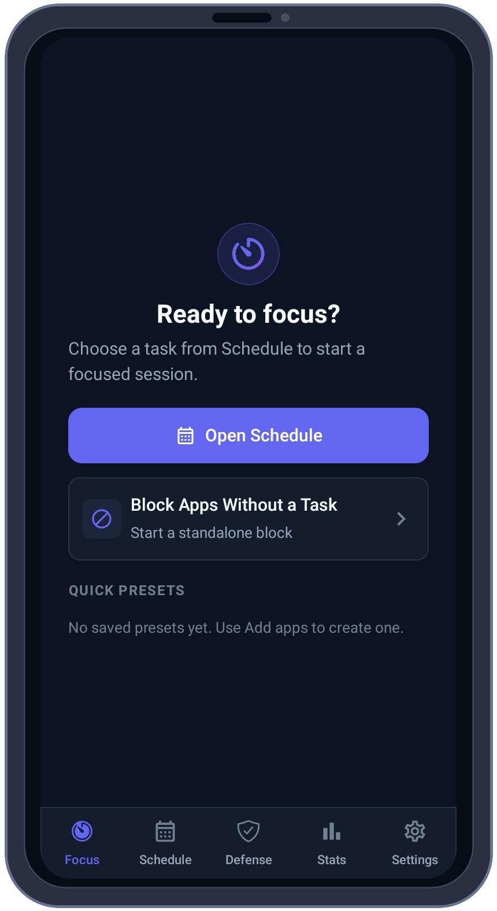
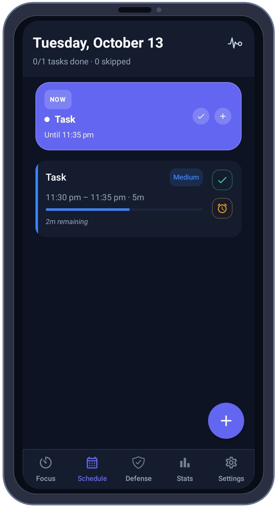
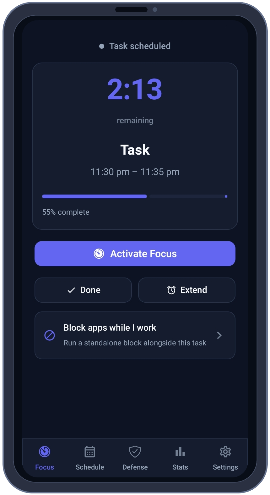
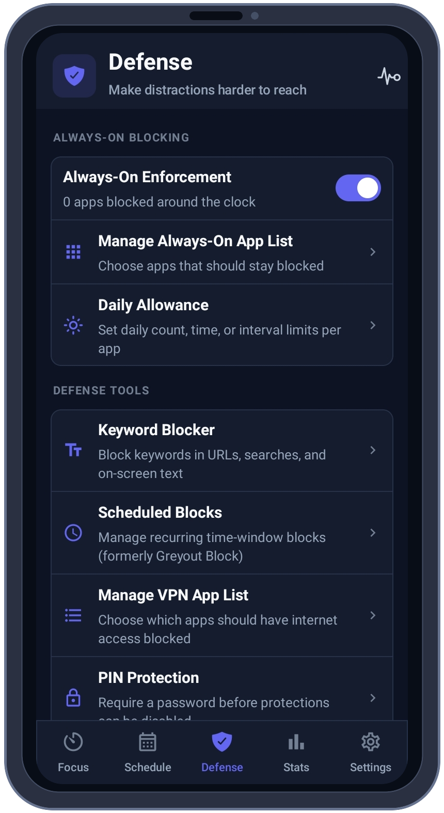
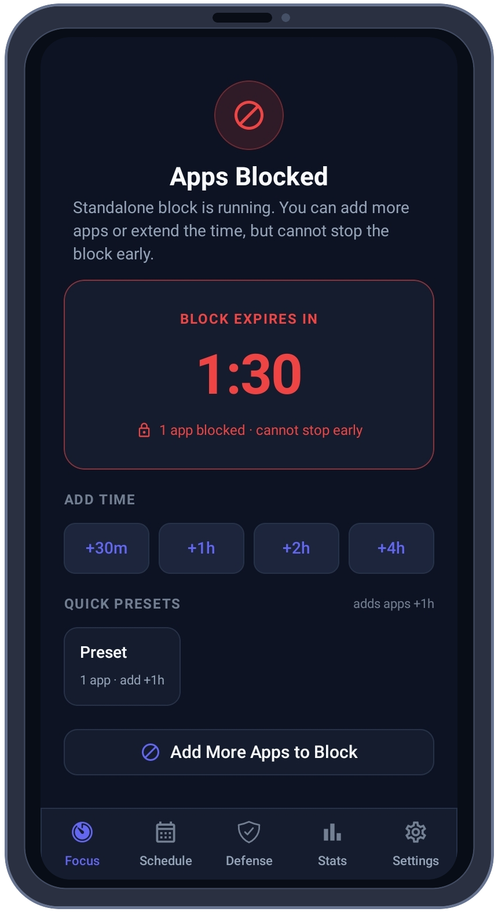
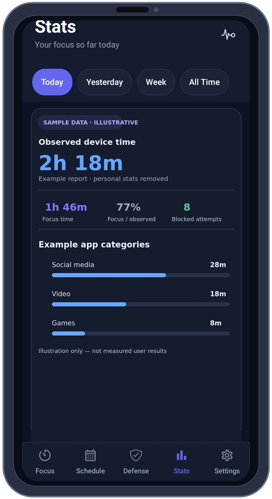
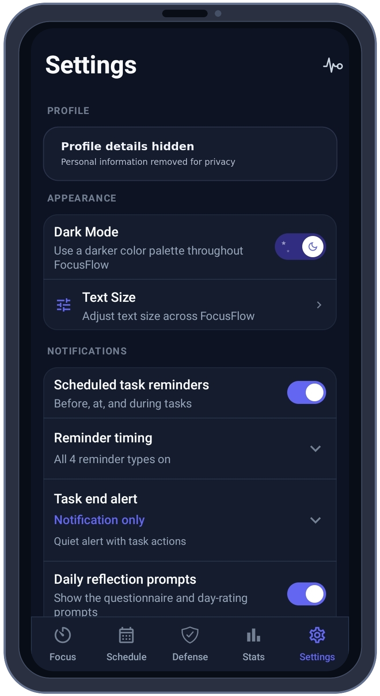

  
  <h1>FocusFlow</h1>
  
<strong>Make room for focus. Keep distractions out.</strong>

  
Plan focused time, block distracting apps, and build routines that work for you — right on your Android phone.

  

    <a href="https://github.com/TITANICBHAI/FocusFlow/releases/latest"><strong>Get FocusFlow for Android</strong></a>
    &nbsp;·&nbsp;
    <a href="https://focusflowapp.pages.dev/">Visit the website</a>
  

  
  
  

## Focus that fits your day

FocusFlow is a free Android focus and app-blocking app. Schedule a work session, set limits for distracting apps, or keep selected apps blocked around the clock. Its protections use Android’s built-in services and keep your focus setup and reports on your device.

### What you can do

- **Plan focus sessions** around tasks and schedules, with a countdown and reminders.
- **Block apps your way** with task-based, timed, scheduled, or always-on blocks.
- **Set daily allowances** for selected apps using open-count, time-budget, or interval limits.
- **Block distractions at different levels** with keyword controls and optional local VPN app blocking.
- **Review your patterns** with on-device usage stats and focus reports.
- **Add protection** with PIN controls and Android system safeguards.

Requires Android 10 or later. No root required.

## Screenshots

The screenshots below are framed and cropped to remove the phone’s status and system navigation bars. Profile details are redacted. **The Stats image uses clearly labeled illustrative data, not measured results.**

<table>
  <tr>
    <td align="center"> Start focus or block apps</td>
    <td align="center"> Plan tasks and sessions</td>
    <td align="center"> Keep a session on track</td>
  </tr>
  <tr>
    <td align="center"> Choose your protections</td>
    <td align="center"> Stay with a timed block</td>
    <td align="center"> Stats · illustrative sample data</td>
  </tr>
  <tr>
    <td colspan="3" align="center"> Settings · profile details redacted</td>
  </tr>
</table>

## Built natively for Android

FocusFlow is a native Android app built with **Kotlin** and **Jetpack Compose**. It uses Android’s Accessibility Service, foreground services, UsageStats, Device Admin, and optional `VpnService` for its focus and blocking features. Tasks and app data are stored locally with Room/SQLite.

## Get the app

Download the latest APK from [GitHub Releases](https://github.com/TITANICBHAI/FocusFlow/releases/latest). Choose the APK that matches your device; use the universal APK if you are unsure.

## License

FocusFlow is licensed under **CC BY-NC-SA 4.0**. You may share and adapt it with attribution, for non-commercial use, and under the same license.
